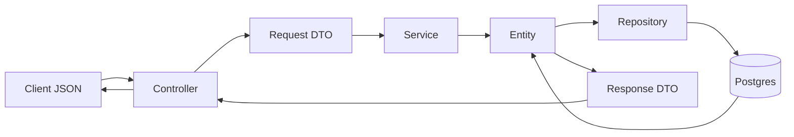

# DTO и слои

Два стека. Constructor, orchestrator и jmeter-builder — Spring Boot: Controller, Service, Repository, JPA Entity. Analyzer, k6-generator, gatling-generator и analysis — FastAPI: Request DTO на Pydantic, без Entity и Repository. Сценарий (`Scenario`) — общий JSON-контракт, не строка таблицы.

### 1. Роль DTO в архитектуре проекта

- Request DTO и Response DTO держат внешний контракт. JPA Entity (`constructor` и `orchestrator`, пакет `persistence`) остаётся внутри Service и Repository. Клиент не получает `passwordHash`, `mustChangePassword`, сырой `scenarioJson` и `reportJson`.
- Контроллер принимает только поля record-а. `CreateUserRequest` содержит `username`, `password`, `role`, `ldapOnly`. Идентификатор, хеш и флаг смены пароля выставляет `UserService`. Лишние поля JSON Jackson отбрасывает: `@RequestBody` не биндится в Entity, поэтому mass assignment в колонки `portal_users` не проходит.
- Схема Postgres меняется changelog-ом Liquibase и полями Entity. Контракт меняется, когда меняется record в `web.dto` или модель Pydantic. Отчёт анализа наружу идёт как `Map` в `AnalysisDtos.RunDto.report`: форму задаёт каталог сервиса analysis, Java её не дублирует.

### 2. Архитектурный путь данных (Data Flow)

Путь на примере создания пользователя (`POST /api/users`) и постановки анализа (`POST /api/analysis`). Оба пишут Entity.

1. **Controller (Transport Layer).** `UserController.create` и `AnalysisController.create` принимают `@RequestBody`. Jackson десериализует JSON в `CreateUserRequest` или `AnalysisDtos.CreateRequest` (`SNAKE_CASE`, `non_null`, enum без учёта регистра). Несовпадение типа ломает разбор до входа в метод. Аннотаций `@Valid` на методах нет.
2. **Service (Business Logic Layer).** `UserService.create` проверяет логин и длину пароля, считает BCrypt и собирает `UserEntity` конструктором. `AnalysisService.create` проверяет цель и окно, собирает `AnalysisRunEntity` и JSON запроса к analysis. Правила «не снять роль у последнего admin», «LDAP-пользователю не задавать локальный пароль» живут здесь. Ошибка — `IllegalArgumentException`; `ApiExceptionHandler` отдаёт `{ "error": "..." }` со статусом 400, 403 или 404.
3. **Repository (Data Access Layer).** `UserRepository.save` и `AnalysisRunRepository.save` пишут Entity. Схему накатывает Liquibase, Hibernate работает в `ddl-auto: validate`. `open-in-view: false`: ленивых загрузок из контроллера нет.
4. **Response Flow.** Service собирает Response DTO вручную и возвращает его контроллеру. `UserService.toDto` копирует `username`, `role`, `enabled`, `ldapOnly`. `AnalysisService.toDto` копирует поля карточки; `report` заполняется только в `GET /api/analysis/{id}`. Список отдаёт `report = null`. Jackson сериализует record в JSON.

Сценарий этот путь не повторяет. `POST /api/builds/save` принимает `BuildSaveRequest` (record `Scenario` + `engine`). `Scenario` — доменная модель в `model`, не Entity. `BuildHistoryService` сериализует её в текст и кладёт в колонку `BuildRecordEntity.scenarioJson`. Генераторы получают тот же JSON. Обратно `fromJson` читает колонку в `Scenario`. Отдельного Response DTO сценария нет: наружу уходит `BuildSaveResponse` с идентификаторами.

Python-сервисы останавливаются на шаге 1–2. FastAPI разбирает тело в `AnalyzeRequest` или `ScenarioDraft`, функция считает отчёт или файл скрипта. В Postgres они не пишут.



### 3. Стек валидации и маппинга в проекте

**Java.** В `constructor/build.gradle`, `orchestrator/build.gradle` и `jmeter-builder/build.gradle` подключён `spring-boot-starter-validation` (Jakarta Validation, Hibernate Validator). Constraint-аннотаций на DTO нет, `@Valid` контроллеры не ставят, поэтому Bean Validation на запросе не срабатывает. Структурный разбор делает Jackson на `@RequestBody`. Смысловые проверки пишет Service до создания Entity.

Маппера MapStruct и ModelMapper в проекте нет. Преобразование — конструктор Entity и приватный метод Service:

```java
UserEntity u = new UserEntity(name, hash, role, req.ldapOnly());
userRepository.save(u);
return new UserDto(u.getUsername(), u.getRole(), u.isEnabled(), u.isLdapOnly());
```

Тот же приём: `AnalysisService.toDto(AnalysisRunEntity, boolean)`. Сценарий маппится Jackson-ом: `ObjectMapper.writeValueAsString(Scenario)` и `readValue(json, Scenario.class)` в `BuildHistoryService`.

**Python.** Pydantic 2.10 (`analysis/requirements.txt` и аналоги генераторов). FastAPI валидирует модель до вызова эндпоинта. `AnalyzeRequest._window_sane` — `@model_validator(mode="after")`: при `window_from >= window_to` клиент получает 422. Повторная проверка бизнес-условий — в теле `analyze` (`HTTPException` 400). Entity нет: `ScenarioDraft` и есть контракт, генератор читает его поля напрямую. Отчёт analysis обратно в Java приходит JSON-объектом и хранится в `report_json` без Java-модели полей находки.
