# Схема пайплайна: сценарии, интеграции, вердикт

Вердикт quality gate считается по файлам итогов на поде генератора. VictoriaMetrics в этот расчёт не входит: туда уходит живая телеметрия для Grafana и модуля анализа.

## Кто с кем говорит


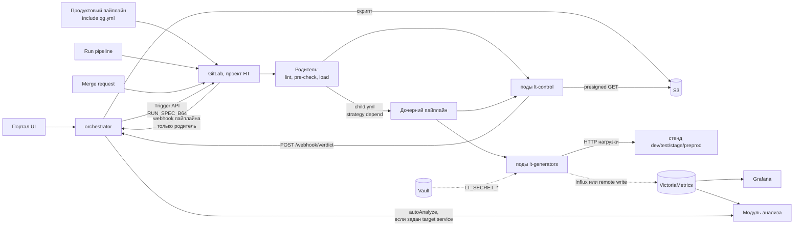

Пунктир есть только когда заданы переменные. Без `LT_INFLUX_URL` JMeter в VictoriaMetrics не пишет. Без `K6_PROMETHEUS_RW_SERVER_URL` k6 туда не пишет. Gatling из `lt-run` в VictoriaMetrics не пишет вообще. Секреты появляются только если в спецификации есть `secrets` или в шаблоне задан `LT_QG_SECRETS`.

## Какой сценарий какие стадии включает


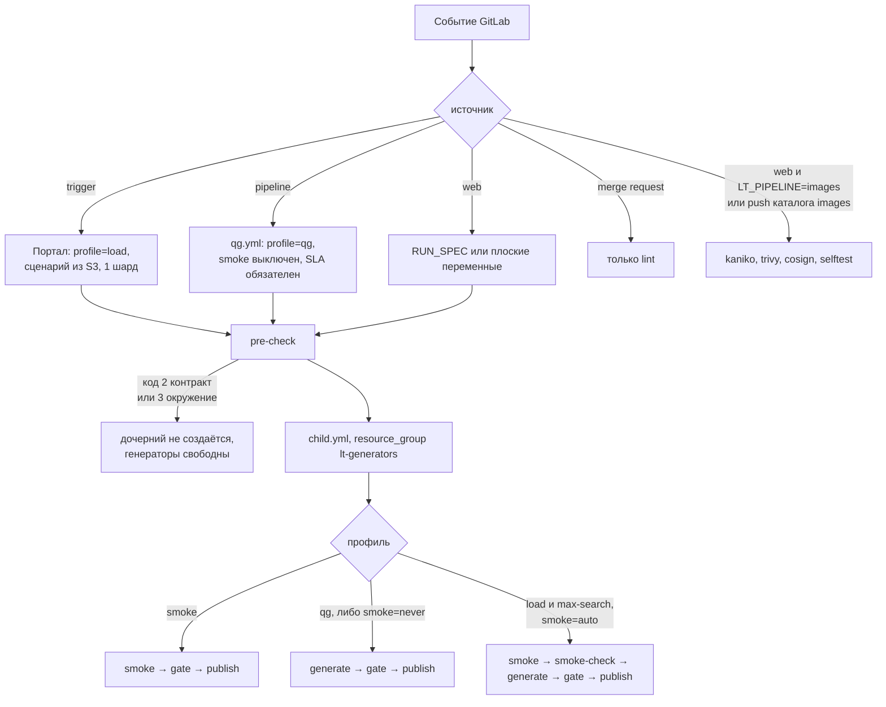

`load` и `max-search` отличаются лимитом длительности и тем, что для них обязателен `run.jira`. Стадии одни и те же. Если до начала окна меньше бюджета smoke, режим `auto` пропускает smoke и идёт сразу в `generate`.

Портал сейчас всегда шлёт `profile=load`, `replicas=1` и сценарий `source=s3`. Блока `sla` в этом запросе нет. Пороги p95, ошибок и RPS в такой прогон не попадают, пока их не добавят в `RUN_SPEC`.

| Вход | CI_PIPELINE_SOURCE | Что получает pre-check | Стадия smoke | Нагрузка | Пороги SLA | Обратно в портал |
|---|---|---|---|---|---|---|
| Портал UI / API | trigger | load, сценарий из S3, 1 шард | да, auto | да | нет, пока launcher не кладёт sla | webhook плюс publish, если задан callback |
| Продуктовый qg.yml | pipeline | qg, сценарий из git репозитория НТ, 1 шард | нет | да | да, пороги LT_QG_* | статус GitLab. publish в портал только при callback |
| Run pipeline в GitLab | web | как в RUN_SPEC или плоских переменных | auto по профилю | кроме profile=smoke | если блок sla есть в спецификации | publish, если есть portal_run_id и callback |
| Merge request | merge_request_event | только lint | нет | нет | нет | нет |
| Сборка образов | web LT_PIPELINE=images или push images/** | kaniko, trivy, cosign, selftest | нет | нет | нет | нет |

## Прогон из портала, все вызовы

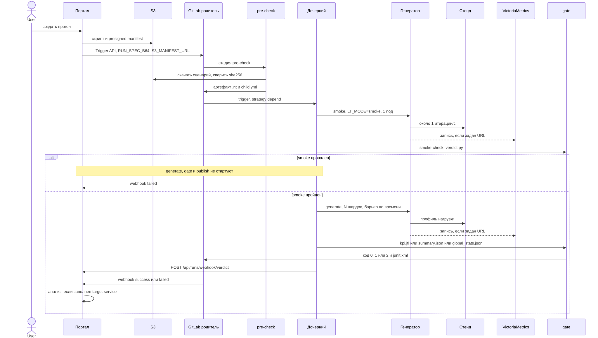

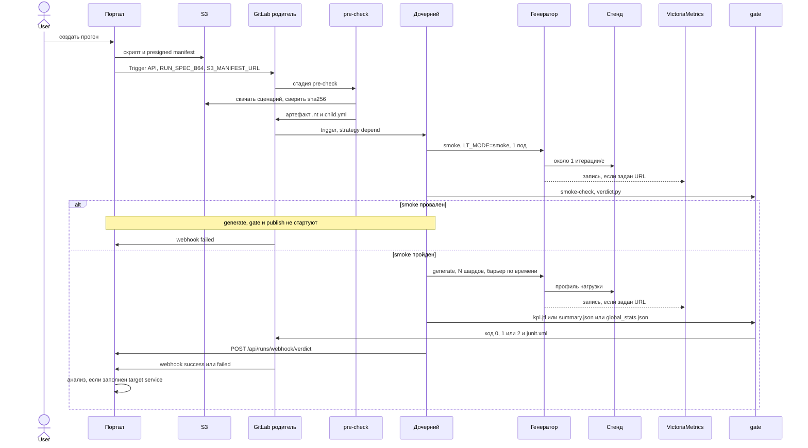

Отмена идёт отдельным вызовом: портал бьёт в GitLab API cancel, под получает SIGTERM через tini, инструмент успевает дописать `meta.json`.

Ручной запуск повторяет эту цепочку после `pre-check`. Сценарий `source=git` уже лежит в checkout, в S3 pre-check не ходит. `source=portal` pre-check отклоняет.

## Продуктовый quality gate

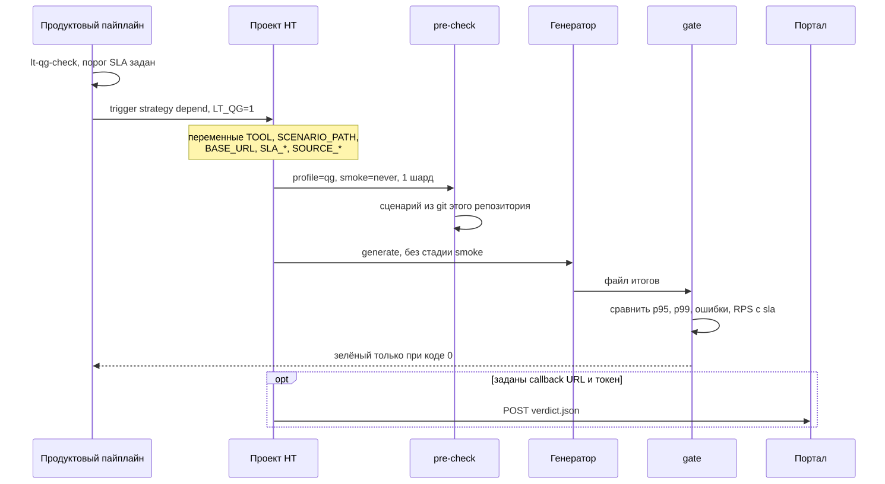

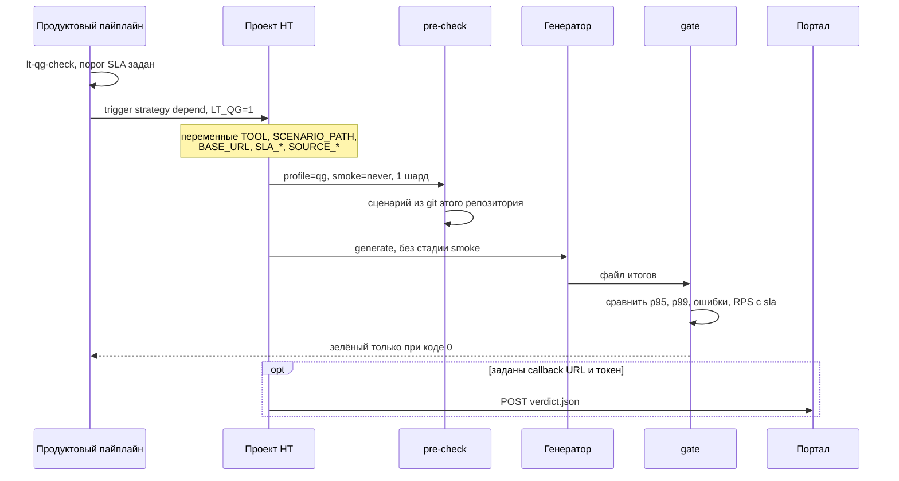

Для продукта гейт — это статус джобы `lt-quality-gate`. `passed` оставляет пайплайн зелёным. `failed` и `invalid` оба делают его красным: GitLab не различает коды 1 и 2. Точная причина лежит в `verdict.json` и в портале, если callback дошёл.

На merge request продуктовый шаблон гейт не запускает, пока не включён `LT_QG_ON_MR`.

## Откуда берутся числа для вердикта


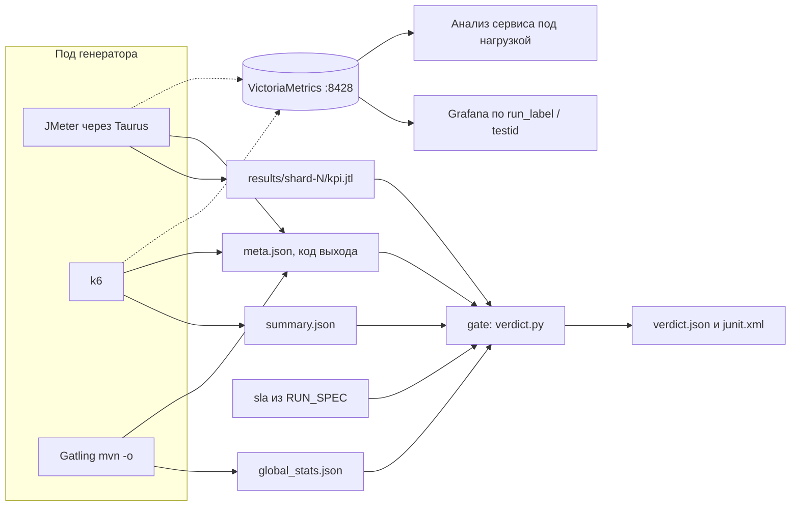

| Инструмент | Что читает gate | Перцентиль | Когда шард сам становится failed | Живая запись в VictoriaMetrics |
|---|---|---|---|---|
| JMeter | `kpi.jtl` | точный p95/p99 по всем сэмплам шардов | код 3, порог Taurus | Influx line protocol, если задан `LT_INFLUX_URL` |
| k6 | `summary.json`, поля `p(95)` и `p(99)` | при нескольких шардах максимум, `exact=false` | код 99, threshold в скрипте | remote write, если задан `K6_PROMETHEUS_RW_SERVER_URL` |
| Gatling | `global_stats.json` | `percentiles3` это p95, `percentiles4` это p99 | любой ненулевой код, если итоги уже есть | из `lt-run` не пишет |

Сравнение одно: `p95_ms` и `p99_ms` и `error_rate_pct` не выше порога, `rps` не ниже `min_rps`. Нет сэмплов или нет нужной метрики — `invalid`. Приоритет статуса: `invalid`, затем `failed`, затем `passed`.

| verdict.json | Код gate | GitLab и продуктовый пайплайн | Прогон в портале после publish |
|---|---|---|---|
| passed | 0 | зелёный | SUCCEEDED, error очищен |
| failed | 1 | красный | FAILED, причины SLA в error |
| invalid | 2 | красный, как failed | FAILED, причины недостоверности в error |

Publish ходит на `POST /api/runs/webhook/verdict` с тем же `X-Gitlab-Token`, что webhook пайплайна. Сбой доставки не перекрашивает gate. Webhook GitLab игнорирует дочерний пайплайн и видит только success или failed родителя.

Smoke перед нагрузкой смотрит те же файлы, но SLA по задержке не применяет. Нужен код 0, ошибки не выше порога и хотя бы один сэмпл. Для JMeter gate ещё сверяет имена из JMX с метками в `kpi.jtl`. У k6 и Gatling покрытие сидит в самом скрипте: thresholds и assertions, то есть в коде выхода.

Провал этого smoke останавливает цепочку раньше gate. `generate` зависит от `smoke-check`, у `gate` зависимость не optional, поэтому `gate` и `publish` не запускаются. Портал получает только webhook `failed`, без `verdict.json`.

## Сборка образов

Это отдельный пайплайн того же репозитория. Портал, S3, стенд и Vault сценария в нём не участвуют.


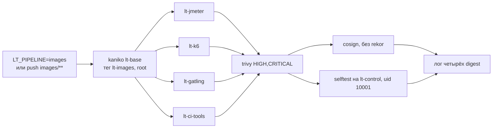

`image-digests` печатает строки для `LT_IMAGE_*`. В git их переносит отдельный MR.
